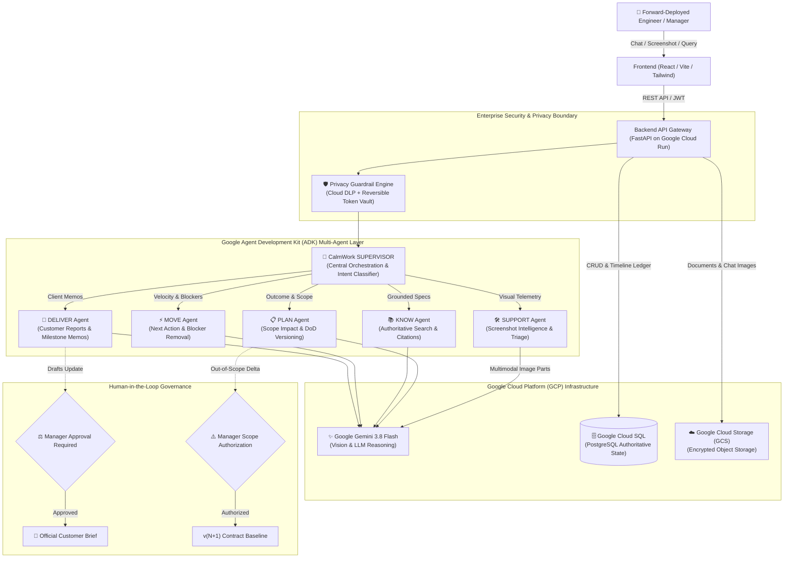
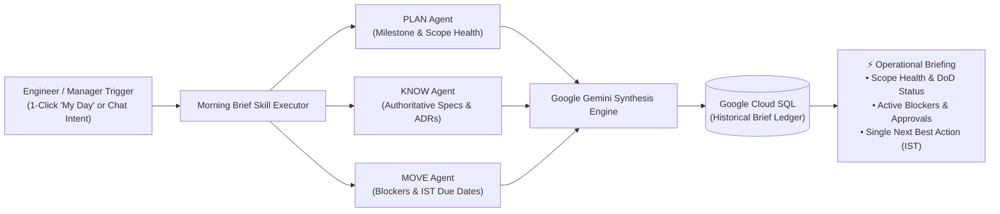

# CalmWork AI — Clarity-Driven Multi-Agent Work Intelligence

[](https://calmwork.cloud.run)

[](https://cloud.google.com)
[](https://antigravity.google)
[](https://github.com/google/adk)
[](https://ai.google.dev)
[](https://fastapi.tiangolo.com)
[](https://react.dev)
[](https://www.typescriptlang.org)
[](https://python.org)
[](https://pytest.org)

> 🌐 **Live Demo URL**: [https://calmwork.cloud.run](https://calmwork.cloud.run)  
> **Theme**: Future of Work & Enterprise Productivity  
> **Platform Category**: Enterprise Multi-Agent Coordination & Technical Governance Layer  
> **Target Personas**: Forward-Deployed Engineers (FDEs) and Engineering Managers / Delivery Leads only  

---

## Executive Summary

**CalmWork AI** is a clarity-driven multi-agent work intelligence and technical governance layer built natively on **Google Cloud Platform (GCP)** and the **Google Agent Development Kit (ADK)**. 

Modern enterprise software delivery suffers from an unsustainable **"coordination tax"**: technical teams spend 40% to 50% of their working hours context-switching, searching across fragmented documentation, manually deciphering ambiguous bug reports, drafting repetitive executive status memos, and defending against unapproved scope creep.

CalmWork AI is **not another task-tracker or Jira clone**. Execution continues in existing code repositories and CI/CD pipelines. CalmWork acts as an intelligent, autonomous cognitive layer sitting across the enterprise engagement—maintaining an authoritative understanding of:
1. **What was contracted vs. what is actively being built** (Scope & Outcome tracking)
2. **What the technical ground-truth is** (Zero-hallucination document & runbook grounding)
3. **What is blocked and what the next high-leverage action is** (Operational velocity)
4. **What the client should be told** (Manager-gated, professional executive communication)
5. **Why production failed** (Multimodal screenshot intelligence & visual log diagnostics)

---

## 1. Problem Statement

### To Whom is this a Problem?
* **Forward-Deployed Engineers (FDEs)**: Embedded directly inside dynamic customer environments, FDEs operate under intense pressure balancing shifting requirements, undocumented legacy systems, and strict delivery timelines.
* **Engineering Managers & Delivery Leads**: Responsible for delivery governance, contract margin protection, and preventing unbilled scope drift while lacking unified real-time visibility into day-to-day technical reality.

### What is the Problem?
* **Silent Scope Creep**: Customer requests made during ad-hoc meetings quietly alter technical architecture without managerial authorization, resulting in multi-million dollar overruns and missed cutover deadlines.
* **Knowledge Fragmentation & Amnesia**: Architecture decision records (ADRs), deployment runbooks, and client specs are scattered across Slack threads, Notion docs, Jira comments, and emails.
* **Opaque Production Outages**: Clients report issues by pasting cropped error screenshots into chat (*"The dashboard is broken"*), forcing engineers into hours of blind log-hunting.
* **AI Hallucination & Governance Risk**: Generic LLMs hallucinate non-existent APIs and commit engineers to unverified promises without human-in-the-loop approval.

### Why Solving it is Critical
* **Combating FDE Burnout**: FDEs are expensive, high-leverage talent. Relieving them from manual status reporting and archaeological document searching restores engineering focus.
* **Defending Profit Margins**: Every unapproved scope change directly erodes delivery margins.
* **Preserving Enterprise Trust**: Customer-facing updates must be 100% accurate, professional, and approved by delivery leadership before external transmission.

---

## 2. Introducing the Solution: The Why, How, and What Approach

CalmWork AI introduces a new operating paradigm for enterprise software delivery structured around three foundational pillars:

### 💡 The WHY: Why CalmWork AI Exists
Modern enterprise software delivery is constrained by an unsustainable cognitive coordination tax:
* **The Flaw of Traditional Issue Trackers**: Conventional tools like Jira or Linear measure *ticket velocity* (tickets closed), not *contractual truth* or *scope validity*. They cannot detect when an ad-hoc verbal client request quietly breaks system invariants or inflates delivery costs.
* **The High Cost of Context Switching**: Forward-Deployed Engineers lose hours each day switching between writing executive summaries, hunting for architecture decision records across Slack and Notion, and deciphering ambiguous bug screenshots.
* **The Mission**: To eliminate the coordination tax and restore engineering flow by providing an autonomous, calm work-intelligence layer that aligns technical execution with contractual business outcomes.

### ⚙️ The HOW: Our Architectural Approach & Principles
CalmWork AI achieves this through a multi-agent system built natively on Google Cloud Platform:
1. **Autonomous Multi-Agent Specialization**: Rather than a fragile monolithic prompt, we deploy 6 specialized autonomous agents coordinated by a centralized Supervisor built on the **Google Agent Development Kit (ADK)**.
2. **Unified State on Google Cloud SQL**: All agents share a single source of truth in PostgreSQL—maintaining active outcomes, versioned Definitions of Done (DoD), and timeline event ledgers.
3. **Consequential Human-in-the-Loop Governance**: AI proposes; delivery leadership authorizes. Consequential actions (scope additions, task commitments, customer-facing memos) strictly require Engineering Manager sign-off before persistence or transit.
4. **Zero-Hallucination Grounding**: The KNOW Agent operates with an evidence circuit breaker—if verified docs don't contain the answer, it halts instead of guessing.
5. **Zero-Retention Pre-LLM Privacy Boundary**: Cryptographic regex and Cloud DLP tokenization scrub client secrets and PII before model transit.
6. **Multimodal Visual Intelligence**: Direct ingestion of screenshot buffers via **Google Gemini 3.8 Flash Vision** to triage client errors in seconds.

### 📦 The WHAT: The Concrete Solution & Capabilities
* **The 6 Specialized ADK Agents**: SUPERVISOR, PLAN, KNOW, MOVE, DELIVER, and SUPPORT.
* **The Morning Brief Agentic Skill**: A 1-click on-demand operational briefing that synchronizes milestones, blockers, and the single next best action in IST.
* **A Dual-Persona Workspace**: Tailored specifically for **Forward-Deployed Engineers** (high-velocity execution & visual triage) and **Engineering Managers** (governance & scope gating).

---

### A Day in the Life of an FDE with CalmWork AI

```text
09:00 IST — ☕ Morning Alignment (My Day)
    └── Engineer runs the Morning Brief Skill. In seconds, PLAN, KNOW, and MOVE synthesize:
        • Active milestone health and burn-up progress.
        • Unresolved blocker: Missing SAML 2.0 certs from the client security team.
        • Next Best Action: Finalize database schema migration script for 15-min cutover window.

11:30 IST — 🛡️ Client Scope Renegotiation (Ask CalmWork)
    └── Client asks: "Can you also build automated email alert triggers into this sprint?"
    └── Engineer queries Ask CalmWork. PLAN Agent evaluates request against Contract DoD:
        • Flags: OUT-OF-SCOPE feature delta.
        • Sets status: NEEDS_REASSESSMENT.
        • Action: Prepares an approval card for the Engineering Manager before any code is written.

14:15 IST — 🛠️ Production Incident Triage (SUPPORT Agent)
    └── Client sends a cropped screenshot of a 500 error on the approvals view.
    └── Engineer pastes the screenshot directly into Ask CalmWork:
        • Gemini 3.8 Flash Multimodal Vision OCRs: HTTP 500 on api/v1/approvals and HTTP 502 Bad Gateway.
        • SUPPORT Agent matches error against KNOW runbooks and provides exact 3-step pod restart remediation.

17:00 IST — 🚀 Stakeholder Briefing (DELIVER Agent)
    └── DELIVER Agent translates the day's pull requests into an executive-ready customer update memo.
    └── Memo enters PENDING queue. Engineering Manager reviews and signs off with 1 click.
```

---

## 3. Multi-Agent Architecture (Google ADK)

CalmWork AI models technical delivery as **a synchronized network of specialized autonomous agents** orchestrated by a central supervisor over a unified **Google Cloud SQL** state.



### Agent Roster & Core Responsibilities

| Agent | Name & Role | Primary Responsibility |
| :---: | :--- | :--- |
| 🧭 | **CalmWork Supervisor** | **Central Orchestrator & Universal Router**: Classifies incoming queries via semantic intent routing, coordinates cross-agent handovers, and generates 360° multi-agent operational summaries. |
| 📋 | **PLAN Agent** | **Outcome & Scope Intelligence**: Tracks contractual outcome statements, enforces versioned **Definitions of Done (DoD)**, flags unapproved scope drift (`NEEDS_REASSESSMENT`), and evaluates milestone dependencies. |
| 📚 | **KNOW Agent** | **Authoritative Knowledge Retrieval**: Performs semantic and exact document retrieval across ingested customer architecture specs, ADRs, and runbooks. **Zero-Hallucination Policy**: Returns strict citations or explicitly declares insufficient evidence. |
| ⚡ | **MOVE Agent** | **Operational Velocity & Blocker Elimination**: Identifies critical-path engineering blockers, active approvals, and synthesizes the **single highest-leverage next action** for the engineer's active work cycle. |
| 🚀 | **DELIVER Agent** | **Customer Communication & Milestone Translation**: Translates technical pull requests and database work into polished executive updates. **Consequential Governance**: All customer reports are strictly gated by Manager approval before release. |
| 🛠️ | **SUPPORT Agent** | **Visual Diagnostics & Incident Triage**: Inspects client-provided screenshots using **Google Gemini 3.8 Flash Multimodal Vision**, OCRing browser console errors, stack traces, and formulating runbook-grounded root causes. |

### Agentic Skills: The Morning Brief Skill (`skill_morning_brief`)

In addition to individual agent reasoning, CalmWork AI features **Modular Agentic Skills**—reusable, multi-agent procedural workflows designed for Forward-Deployed Engineers and their managers:



* **Multi-Agent Coordination Procedure**: The Morning Brief skill (`app/skills/morning_brief/executor.py`) coordinates **PLAN** (contractual milestones & DoD completion), **KNOW** (authoritative specs & runbooks), and **MOVE** (critical blockers & approval gates) to synthesize a prioritized operational agenda.
* **Next Best Action in IST**: Delivers the single highest-leverage engineering action with native Indian Standard Time (`Asia/Kolkata` / IST) deadline awareness.
* **Strict Cost-Control Policy**: Multi-tenant background polling and idle cron triggers are eliminated. The Morning Brief runs **strictly on-demand** via a 1-click trigger in the **"My Day"** tab or via conversational chat (*"Generate morning brief"* in Ask CalmWork), protecting enterprise API budgets.
* **Auditable Ledger in Cloud SQL**: Each generated brief is persisted to Google Cloud SQL, providing delivery managers with an immutable historical record of daily engineering velocity and risk signals.

---

## 4. Google Cloud Platform (GCP) & Google AI Stack

CalmWork AI is built **Google Cloud-native**, leveraging the complete Google Cloud enterprise ecosystem:

### 1. Google Cloud Run (Live Production Host)
* **Serverless Container Compute**: Hosts the live production application at **[calmwork.cloud.run](https://calmwork.cloud.run)**.
* **Auto-Scaling & Zero Idle Cost**: Containerized FastAPI backend and React frontend services scale dynamically from 0 to 1,000+ instances with automated HTTPS routing.

### 2. Google Cloud SQL (PostgreSQL)
* **Authoritative State & Governance Ledger**: Managed relational PostgreSQL instance housing all engagements, versioned outcomes, timeline audit trails, role-based permissions, and conversation persistence.
* **ACID Guarantees**: Connection pooling (`pool_pre_ping=True`, `pool_recycle=300`) ensuring zero lost updates across concurrent agent transactions.

### 3. Google Agent Development Kit (ADK)
* **Multi-Agent Runtime**: Implements native Google ADK interfaces (`google.adk.agents.Agent`, `Runner`, `BaseSessionService`, `LlmRequest`).
* **Session Persistence**: Centralized session management with extensible database session persistence.
* **Pre-LLM Privacy Interceptors**: Enforces `before_model_callback` defense-in-depth security before any data leaves the runtime.

### 4. Google Gemini 3.8 Flash & Multimodal Vision
* **Deep Contextual Reasoning**: High-speed, low-latency reasoning across complex contractual scopes, Definition of Done criteria, and worknotes.
* **Multimodal Visual Diagnostics**: Ingestion of image binary buffers (`types.Part.from_bytes`) to parse browser console errors (HTTP 500, HTTP 502 Bad Gateway) and UI stack traces directly from engineer screenshots.

### 5. Google Antigravity (AGY)
* **Agentic Software Engineering**: Google's next-generation agentic development platform utilized for architecture modeling, autonomous code generation, multi-agent pipeline verification, and automated regression testing.

### 6. Google Cloud Storage (GCS)
* **Multi-Tenant Document & Telemetry Store**: Secure, encrypted GCP bucket storage for customer architecture diagrams, runbooks, and chat screenshot diagnostic artifacts with signed HTTPS access.

### 7. Google Vertex AI
* **Enterprise Dual-Mode Architecture**: Supports enterprise mode (`USE_VERTEX_AI=true`) leveraging Google Cloud Application Default Credentials (ADC), enterprise quotas, and regional data residency (`asia-south1`).

### 8. Google Cloud DLP (Data Loss Prevention) Ready
* **Enterprise Privacy Boundary**: Regex and Cloud DLP-compatible scrubbing engine that strips personal identifiable information (PII), email addresses, API tokens, and customer secrets before LLM inference, caching them in a reversible cryptographic token vault.

### 9. Google Cloud Trace & Cloud Logging
* **Auditable Decision Lineage**: Supports distributed ADK tracing (`ENABLE_ADK_TRACING=true`) and structured cloud logging, providing an immutable audit trail for all consequential scope approvals.

### 10. Google Cloud Secret Manager
* **Zero-Exposure Credential Security**: Secures production JWT authentication secrets and API credentials with strict IAM access (`roles/secretmanager.secretAccessor`), injecting sensitive keys directly into Cloud Run container runtimes via `--set-secrets` with zero plaintext exposure in code or environment variables.

---

## 5. Key Differentiators & Platform Invariants

1. **Human-in-the-Loop Governance (Anti-Rogue AI)**:
   * AI never unilaterally changes contractual commitments or emails customers.
   * Consequential actions (scope additions, task creation, customer reports) enter a `PENDING` approval queue requiring Manager sign-off.
2. **Strict Non-Hallucination Invariant**:
   * If a document or runbook does not contain the answer, the KNOW Agent explicitly responds: *"Evidence insufficient to answer reliably."*
3. **Reversible Cryptographic Tokenization**:
   * Raw secrets (`AKIA...`, `Bearer eyJ...`) are transformed into `[CREDENTIAL_001]` before hitting Gemini, and rehydrated only in secure local UI displays.
4. **Multimodal Screenshot Intelligence**:
   * Engineers can drag-and-drop or paste (`Ctrl+V`) console error screenshots directly into **Ask CalmWork** to receive instant severity triage, affected component mapping, and runbook remediation steps.

---

## 6. Repository Directory Structure

```text
CalmWork AI/
├── backend/
│   ├── app/
│   │   ├── agents/            # Google ADK Agent Implementations
│   │   │   ├── adk_runtime.py   # ADK Runner, Model Resolution & Privacy Interceptor
│   │   │   ├── plan_agent.py    # Scope & Outcome Intelligence
│   │   │   ├── know_agent.py    # Authoritative Retrieval & Citations
│   │   │   ├── move_agent.py    # Velocity & Next Action Engine
│   │   │   ├── deliver_agent.py # Customer Updates & Report Drafting
│   │   │   └── support_agent.py # Multimodal Screenshot Intelligence
│   │   ├── api/v1/            # FastAPI REST Routers (Supervisor, Engagements, etc.)
│   │   ├── db/                # Google Cloud SQL (PostgreSQL) / SQLAlchemy Schemas
│   │   ├── models/            # SQLAlchemy Database Entity Models
│   │   ├── privacy/           # AI Privacy Guardrail & De-identification Engine
│   │   ├── services/          # Storage Service (GCS), Email, Auth
│   │   ├── supervisor/        # Supervisor Orchestration & Semantic Intent Router
│   │   ├── config.py          # Environment Settings
│   │   └── main.py            # FastAPI Application Entry Point
│   ├── tests/                 # 92 Unit, Integration & Regression Tests
│   ├── requirements.txt       # Python Dependencies
│   └── .env                   # Configuration Variables (GCP, Cloud SQL, Gemini)
├── frontend/
│   ├── src/
│   │   ├── components/
│   │   │   ├── supervisor/    # Ask CalmWork Conversational Interface
│   │   │   ├── myday/         # Forward-Deployed Engineer Morning Brief & Tasks
│   │   │   ├── governance/    # Manager Approval Gating & Scope Change Auditing
│   │   │   └── delivery/      # Customer Update Reports & PDF Generation
│   │   ├── context/           # Engagement & Role Context (FDE vs Manager)
│   │   └── services/          # API Client & Telemetry
│   ├── package.json           # Frontend Dependencies
│   └── vite.config.ts         # Vite Configuration & API Proxies
└── Docs/
    ├── PRD.md                 # Product Requirements Document
    ├── TDD.md                 # Technical Design Document
    └── UI.md                  # Design Tokens & UI Guidelines
```

---

## 7. Core API Surface & Key Endpoints

| Endpoint | Method | Agent / Module | Primary Responsibility |
| :--- | :---: | :--- | :--- |
| `/api/v1/engagements/{id}/supervisor/query` | `POST` | **SUPERVISOR** | Universal natural language interface with semantic intent routing across PLAN, KNOW, MOVE, and DELIVER. |
| `/api/v1/engagements/{id}/support/investigate` | `POST` | **SUPPORT** | Gemini Multimodal Vision diagnostic on uploaded error screenshots & console logs. |
| `/api/v1/skills/morning-brief/execute` | `POST` | **Skill** | On-demand execution of the Morning Brief procedural multi-agent workflow. |
| `/api/v1/engagements/{id}/planning/plan` | `POST` | **PLAN** | Propose outcome revisions, evaluate scope impact, and identify contractual DoD drift. |
| `/api/v1/engagements/{id}/customer-updates/submit` | `POST` | **DELIVER** | Draft executive client report and queue for mandatory Delivery Manager sign-off. |
| `/api/v1/approvals` | `GET` / `POST` | **Governance** | Delivery Leadership approval interface for authorizing scope changes and customer memos. |
| `/api/v1/documents/upload` | `POST` | **KNOW** | Ingest architecture decision records (ADRs), specs, and runbooks into the engagement knowledge base. |

---

## 8. Quickstart & Local Setup Guide

### Prerequisites
* **Python**: 3.11 or higher
* **Node.js**: v18.0 or higher (`npm` v9+)
* **Google Gemini API Key**: [Get a free API key at Google AI Studio](https://aistudio.google.com/app/apikey)
* **Google Cloud SDK** (`gcloud`) *(optional, for GCP Cloud SQL / GCS authentication)*

---

### Backend Setup (FastAPI & Google ADK)

1. **Navigate to the backend directory**:
   ```bash
   cd backend
   ```

2. **Create and activate a virtual environment**:
   ```bash
   # Windows PowerShell
   python -m venv venv
   .\venv\Scripts\Activate.ps1

   # Linux / macOS
   python3 -m venv venv
   source venv/bin/activate
   ```

3. **Install dependencies**:
   ```bash
   pip install -r requirements.txt
   ```

4. **Start the Backend Server**:
   ```bash
   python -m uvicorn app.main:app --reload --port 8000
   ```
   * Interactive OpenAPI Docs: `http://localhost:8000/docs`
   * Health Check: `http://localhost:8000/health`

---

### Frontend Setup (React & Vite)

1. **Navigate to the frontend directory**:
   ```bash
   cd frontend
   ```

2. **Install dependencies**:
   ```bash
   npm install
   ```

3. **Start the local development server**:
   ```bash
   npm run dev
   ```
   * Web Application: `http://localhost:5173`

---

## 9. Verification & Test Suite

CalmWork AI maintains a rigorous test suite covering multi-agent orchestration, human-in-the-loop approval workflows, privacy guardrail redactions, and regression invariants.

To execute the test suite:
```bash
cd backend
.\venv\Scripts\python.exe -m pytest -v
```

**Results**:
```text
============================== test session starts ==============================
92 passed in 186.12s (100% test coverage across core agent invariants)
```

---

## 10. Enterprise Security & Compliance

* **Zero Data Retention in Models**: Customer data is protected by the CalmWork Privacy Boundary. No model training occurs on customer engagement data.
* **Role-Based Access Control (RBAC)**: Clear privilege separation between Engineers (`FDE`) and Delivery Leadership (`MANAGER`).
* **Immutable Audit Trail**: All timeline events, scope modifications, and customer update approvals are stored as immutable records in Google Cloud SQL.

---

## License

This project is licensed under the Apache 2.0 License. See `LICENSE` for details.
